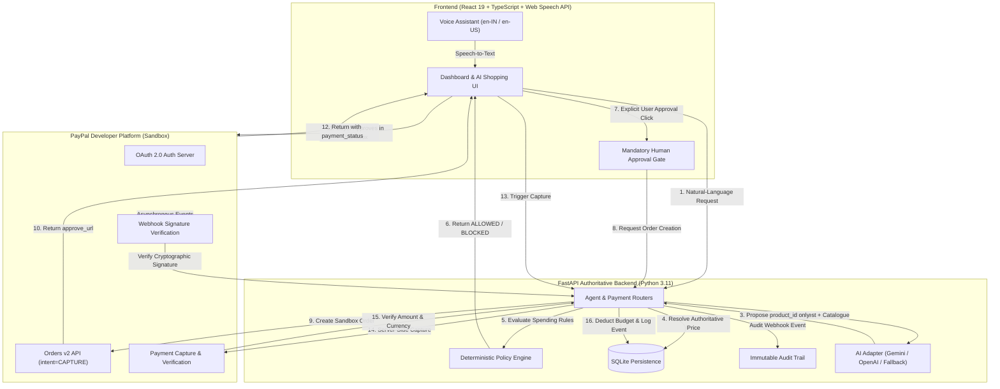

# AgentPay Guard

> **Hackathon Prototype** — PayPal Sandbox only. No real money. Not a production financial product.

Deterministic spending guardrails, human-in-the-loop approvals, verified PayPal Sandbox payments, and conversational voice assistance for autonomous AI commerce. Built for the **PayPal AI Hackathon 2026**.

- **Live Demo:** [https://agentpay-guard-zcet.onrender.com](https://agentpay-guard-zcet.onrender.com)
- **Demo Video:** [Watch Demo Video (AgentPay_Guard_demo_final.mp4)](https://github.com/amansheikh-techie/agentpay-guard/releases/tag/v1.0.0) *(Placeholder)*
- **Repository:** [https://github.com/amansheikh-techie/agentpay-guard](https://github.com/amansheikh-techie/agentpay-guard)

---

## The Problem

Autonomous AI purchasing agents are evolving rapidly from passive recommenders into proactive decision-makers with direct access to checkout interfaces. However, granting generative AI unsupervised payment authority introduces critical financial vulnerabilities:

1. **Prompt Injection & Hallucination:** An LLM cannot be the security boundary. Attackers or hallucinations can mislead an agent into proposing unauthorized $500 items or buying from malicious merchants.
2. **Budget Creep:** Automated, unmonitored micro-transactions rapidly deplete personal and organizational budgets without deterministic accumulation limits.
3. **The Checkout Black Box:** Users will not trust autonomous commerce without complete transparency, verifiable policy checks, and an explicit human-in-the-loop approval gate.

### Core Principle

> **AI proposes → deterministic rules decide → human approves → backend verifies.**

The AI agent proposes product IDs and natural-language rationales, but **never** determines prices, merchant legitimacy, policy outcomes, or payment statuses. All financial guardrails and PayPal transaction verifications are executed exclusively by backend server code.

---

## Architecture



### Trust Boundary & Security Invariants

- **Authoritative Data:** Product prices, currencies, and merchant allowlists live in backend storage—client and AI inputs are strictly untrusted.
- **Approval Binding Invariant:** When an order is created, an immutable cryptographic snapshot (`product_id`, `price_cents`, `merchant_id`, `currency`, and `policy_version`) is stored. Capture fails with `409 Conflict` if catalogue prices or merchant identities drift between approval and capture.
- **Idempotent Reconciliation:** Every PayPal API call sends a unique `PayPal-Request-Id` idempotency key. Duplicate capture requests are deduplicated atomically without double deductions.

---

## How PayPal Developer Platform APIs Are Used

AgentPay Guard integrates deeply with the **PayPal Developer Platform (Sandbox)** to ensure secure, compliant AI-driven transactions:

| PayPal Capability | Implementation | Purpose & Security Guarantee |
| ----------------- | -------------- | ---------------------------- |
| **OAuth 2.0 Client Credentials** | `backend/app/services/paypal_service.py` (`get_access_token`) | Obtains short-lived bearer tokens via server-side Client ID and Secret; tokens are cached in memory to minimize latency. |
| **Orders v2 API (`intent=CAPTURE`)** | `backend/app/services/paypal_service.py` (`create_order`) | Generates sandbox checkout orders using server-authoritative prices converted safely from minor units (cents to decimal string). |
| **Idempotency Protection** | `PayPal-Request-Id: {payment_id}` | Prevents duplicate charge generation even during network retries or repeated browser submissions. |
| **Server-Side Capture Verification** | `backend/app/services/paypal_service.py` (`capture_order`) | Directly calls PayPal to capture payment and verifies `status == "COMPLETED"`, currency, and exact amount before decrementing user budget. |
| **Webhook Signature Verification** | `POST /api/payments/webhook` via `/v1/notifications/verify-webhook-signature` | Cryptographically validates incoming PayPal webhook transmissions (`paypal-transmission-sig`, `paypal-cert-url`) to protect against spoofing. |
| **Cancellation Handling** | `POST /api/payments/cancel` | Cleanly marks orders as `cancelled` when buyer aborts in PayPal Sandbox, releasing reserved funds without touching spend totals. |

---

## Setup in Under 5 Steps

### 1. Clone the Repository

```bash
git clone https://github.com/amansheikh-techie/agentpay-guard.git
cd agentpay-guard
```

### 2. Configure Environment Variables

```bash
cp backend/.env.example backend/.env
```

Open `backend/.env` and insert your PayPal Sandbox credentials from [developer.paypal.com](https://developer.paypal.com/dashboard/applications/sandbox):

```dotenv
PAYPAL_CLIENT_ID=your_sandbox_client_id
PAYPAL_CLIENT_SECRET=your_sandbox_client_secret
PAYPAL_MODE=sandbox
PAYPAL_CURRENCY=USD
FRONTEND_BASE_URL=http://localhost:5173
```

*(Optional: Set `AI_PROVIDER=gemini` and `AI_API_KEY=your_key` for live AI mode; without keys, the app runs in deterministic fallback mode automatically).*

### 3. Install Backend & Frontend Dependencies

```bash
# Backend (Python 3.11+)
cd backend
python -m venv .venv
.venv\Scripts\Activate.ps1    # On Windows (or 'source .venv/bin/activate' on Linux/macOS)
pip install -r requirements.txt
cd ..

# Frontend (Node 18+)
cd frontend
npm install
cd ..
```

### 4. Run the Application

In terminal 1 (Backend):
```bash
cd backend
.venv\Scripts\Activate.ps1
uvicorn app.main:app --port 8000 --reload
```

In terminal 2 (Frontend):
```bash
cd frontend
npm run dev
```

Open your browser at **`http://localhost:5173`**.

### 5. Run Automated Tests

```bash
cd backend
.venv\Scripts\Activate.ps1
pytest -v
```

All 89 unit and integration tests run offline against an in-memory SQLite instance without incurring real network charges.

---

## Environment Variables

| Variable | Required | Default | Description |
| -------- | -------- | ------- | ----------- |
| `APP_ENV` | No | `development` | Deployment environment (`development` or `production`). |
| `DATABASE_URL` | No | `sqlite:///./data/agentpay_guard.db` | SQLite connection URL (auto-creates `backend/data/` if missing). |
| `FRONTEND_ORIGIN` | No | `http://localhost:5173` | Allowed CORS origin for backend API. |
| `FRONTEND_BASE_URL` | No | `http://localhost:5173` | Base URL used to construct PayPal return/cancel redirect URLs. |
| `PAYPAL_MODE` | **Yes** | `sandbox` | Must be `sandbox`. |
| `PAYPAL_CLIENT_ID` | **Yes\*** | `""` | PayPal Sandbox REST App Client ID. |
| `PAYPAL_CLIENT_SECRET`| **Yes\*** | `""` | PayPal Sandbox REST App Client Secret (never exposed to client). |
| `PAYPAL_BASE_URL` | No | `https://api-m.sandbox.paypal.com` | PayPal Sandbox endpoint URL. |
| `PAYPAL_CURRENCY` | No | `USD` | ISO-4217 currency code. |
| `PAYPAL_WEBHOOK_ID` | No | `""` | Webhook ID from PayPal Developer Dashboard for signature verification. |
| `AI_PROVIDER` | No | `none` | AI provider (`gemini`, `openai`, or `none` for deterministic fallback). |
| `AI_API_KEY` | No | `""` | Google Gemini or OpenAI API key (backend only). |
| `AI_MODEL` | No | `gemini-2.5-flash` | LLM model identifier. |
| `ADMIN_TOKEN` | No\*\* | `""` | Admin secret for policy edits and resets outside development mode. |

*\* Required for live PayPal Sandbox checkout; without credentials, non-payment exploration and deterministic fallback remain available.*  
*\*\* Enforced outside `APP_ENV=development` via `X-Admin-Token` constant-time comparison.*

---

## Conversational Voice Assistant

AgentPay Guard features a built-in voice shopping assistant accessible directly in the browser via the standard Web Speech API:

- **Hands-Free Requesting:** Click the microphone icon to speak purchase requests in natural language (e.g., *"Find a wireless mouse for work under thirty-five dollars"*).
- **Accent Selection:** Dedicated toggle supporting `en-IN (India)` and `en-US (United States)` recognition and synthesis models.
- **Spoken Verdicts:** Speaks out authoritative pricing, item name, and explicit rule verdict (`ALLOWED` or `BLOCKED` with reason code).
- **Safety Boundary:** Voice input is strictly a discovery mechanism. Voice commands **cannot** authorize payments or bypass the human confirmation gate.

---

## Repository Structure

```text
agentpay-guard/
├── backend/
│   ├── app/                  # FastAPI routers, models, schemas, and services
│   │   ├── routers/          # agent.py, payments.py, policy.py, health.py
│   │   └── services/         # ai_service.py, paypal_service.py, policy_engine.py
│   ├── data/                 # SQLite database storage (agentpay_guard.db)
│   ├── tests/                # 89 pytest unit and integration test suites
│   ├── requirements.txt      # Python dependencies
│   └── .env.example          # Environment variable template
├── frontend/                 # React 19 + TypeScript + Vite web application
│   ├── src/components/       # DecisionCard, RequestPanel, PolicyOverview, AuditTimeline
│   └── src/api/              # Typed backend REST client
├── docs/                     # Documentation and submission materials
│   ├── SUBMISSION_MATERIALS.md
│   ├── TEST_SCENARIOS.md
│   ├── VOICE_ASSISTANT.md
│   └── screenshots/          # Application screenshot captures
├── render.yaml               # Render Cloud deployment blueprint
├── LICENSE                   # MIT License
└── README.md                 # Project documentation and architecture guide
```

---

## Hackathon Evaluation & Scenarios

To test the deterministic policy engine immediately:

1. **Scenario A (Allowed):** *"Find a wireless mouse under $35 from an approved merchant."* → Proposes TechCore Wireless Mouse (\$29.99). Evaluates as `ALLOWED BY POLICY`. Unlocks mandatory approval button for PayPal Sandbox checkout.
2. **Scenario B (Blocked by Cap):** *"I need a high-end mechanical keyboard."* → Recommends \$79.99 keyboard. Immediately blocked with `MAX_ORDER_AMOUNT_EXCEEDED`. Proposes allowable alternatives within cap.
3. **Scenario C (Blocked by Merchant):** *"Find a gadget from ShadowTech."* → Blocked with `MERCHANT_NOT_APPROVED` because ShadowTech is not allowlisted.
4. **Demo Reset:** Click **"Reset Demo"** in Policy Overview to restore the environment to clean starting limits without wiping historical audit records.
