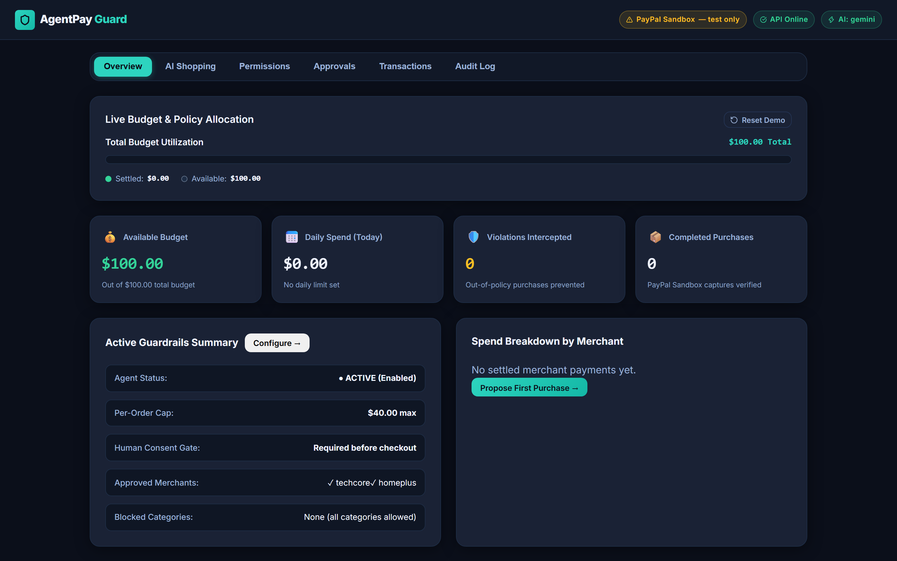
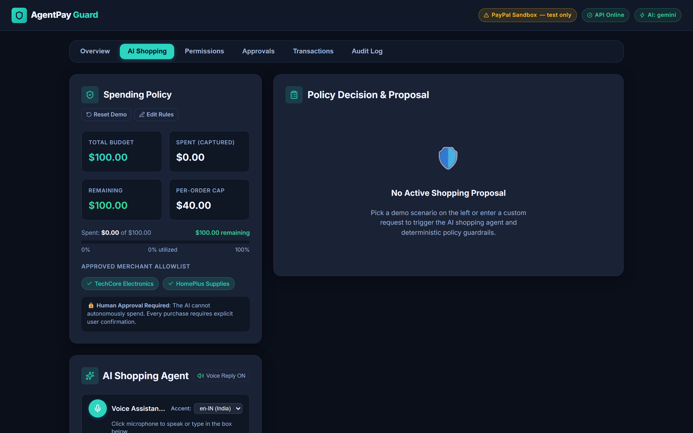
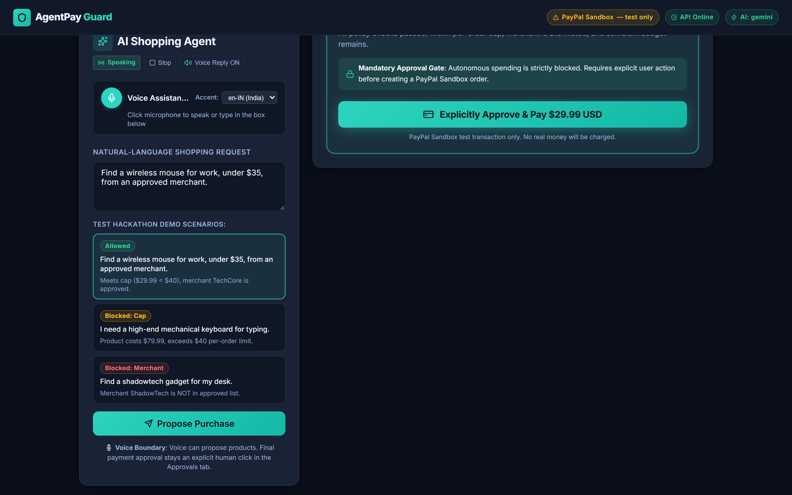
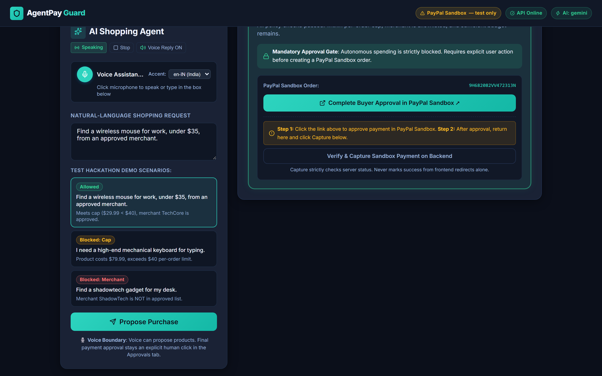
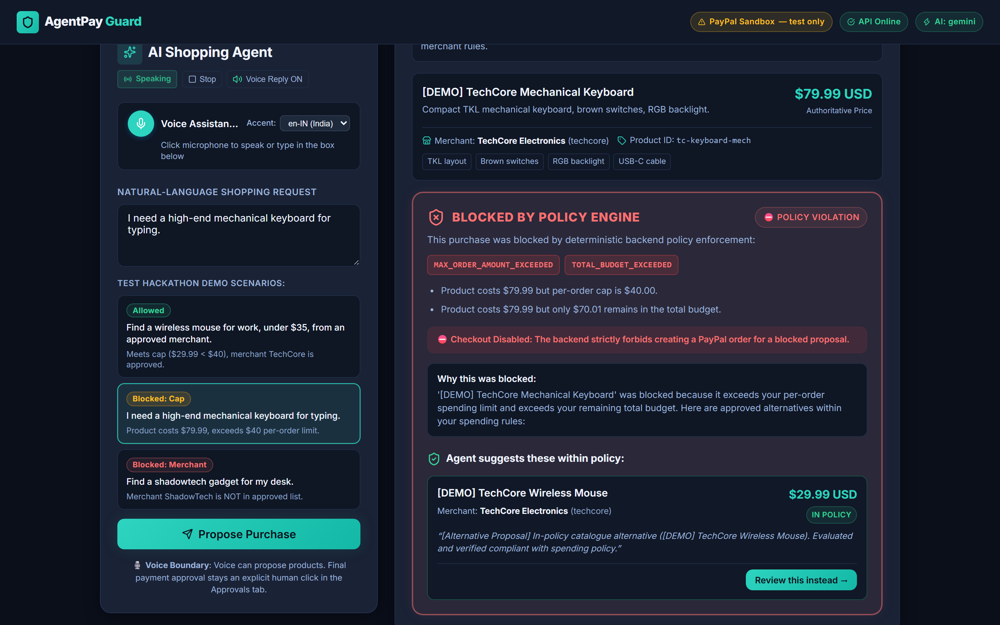
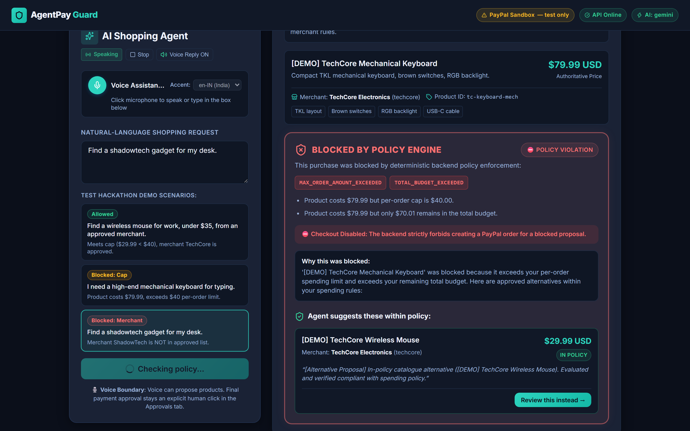
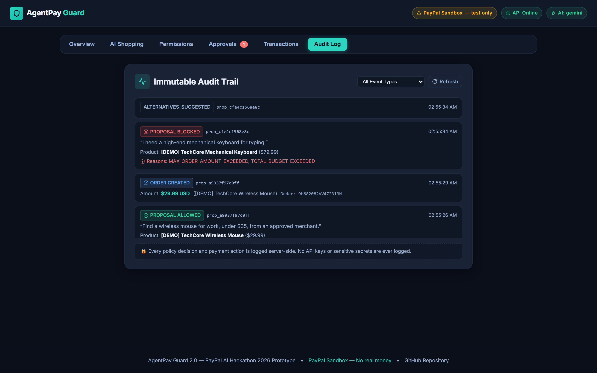
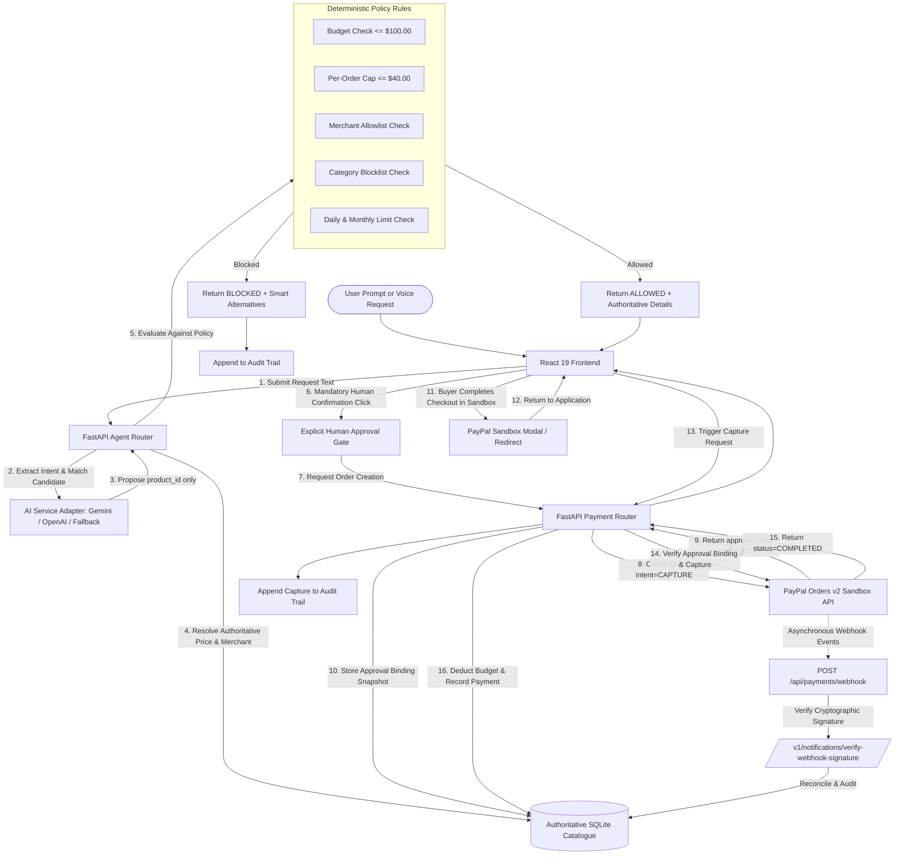

# AgentPay Guard

Autonomous AI Commerce Spending Guardrails, Human-in-the-Loop Approvals, and Verified PayPal Sandbox Settlement.

[](https://agentpay-guard-zcet.onrender.com)
[](LICENSE)
[](https://developer.paypal.com)
[](https://python.org)
[](https://fastapi.tiangolo.com)
[](https://react.dev)
[](https://typescriptlang.org)

---

## Live Demo

- **Application URL:** [https://agentpay-guard-zcet.onrender.com](https://agentpay-guard-zcet.onrender.com)
- **Demo Video:** [https://youtu.be/agZltmxm3o0](https://youtu.be/agZltmxm3o0)
- **Deployment Platform:** Render (Web Service running FastAPI + React static bundle)

*Note: The demo runs on Render free tier infrastructure. If the service is idle, initial startup may take approximately 30 to 60 seconds.*

---

## The Problem

Autonomous AI purchasing agents are evolving rapidly from passive search assistants into proactive software entities capable of executing web-based commercial transactions. Granting generative large language models (LLMs) direct or unsupervised access to payment methods introduces critical security and financial hazards:

1. **Prompt Injection and Model Hallucination:** An LLM cannot serve as a secure boundary. Malicious prompt injections, unexpected reasoning drift, or training hallucinations can cause an AI agent to fabricate prices, select compromised merchants, or purchase unauthorized luxury items.
2. **Unmonitored Budget Depletion:** Rapid, recurring micro-transactions executed by automated agents can silently exhaust personal or enterprise spending allowances without deterministic velocity limits or cumulative window enforcement.
3. **The Unverifiable Checkout Black Box:** Users and compliance officers will not entrust capital to autonomous software without complete visibility, deterministic constraints, and an explicit human confirmation gate prior to financial execution.

---

## The Solution

**AgentPay Guard** is an authoritative proxy and deterministic enforcement firewall positioned between generative AI shopping agents and the PayPal Developer Platform. 

### Core Architectural Principle

> **AI proposes -> Deterministic rules decide -> Human explicitly approves -> Backend verifies with PayPal Sandbox.**

- **Untrusted AI Layer:** The AI model is strictly restricted to discovering catalogue items and extracting purchase intents. The LLM never touches payment credentials, cannot specify purchase prices, and cannot self-approve transactions.
- **Authoritative Backend:** The FastAPI backend resolves all item details, pricing, and merchant allowlists exclusively from internal database records.
- **Deterministic Policy Engine:** An isolated rule engine validates every proposal against hard spending limits ($100 default budget, $40 per-order cap, merchant allowlists, and category restrictions) before any checkout session can be initiated.
- **Human Approval Gate:** Even fully compliant purchases require explicit user confirmation.
- **Authoritative Verification:** Payment capture and ledger adjustments occur strictly on the backend after cryptographic PayPal order status verification.

---

## Application Screenshots

### 1. Mission Control Dashboard

*Real-time spend visualization showing budget limits ($100.00 total, $40.00 per-purchase cap), remaining balance, active policy guardrails, and approved merchant registry.*

### 2. Conversational Voice Assistant

*Browser-native Web Speech API interface enabling hands-free shopping discovery with real-time transcription and accent selection (`en-IN` India and `en-US` United States).*

### 3. AI Shopping Proposal Evaluated Within Policy

*Natural-language request evaluated by the deterministic engine: TechCore Wireless Mouse ($29.99) passes all limits and unlocks the explicit human approval checkout button.*

### 4. Verified PayPal Sandbox Order Creation

*Explicit human authorization creates a PayPal Orders v2 Sandbox order with an approval binding token, ready for secure buyer checkout.*

### 5. Policy Enforcement: Blocked for Exceeding Per-Purchase Cap

*Mechanical Gaming Keyboard ($79.99) blocked for exceeding the $40.00 limit, automatically surfacing in-policy Smart Alternatives ($39.99).*

### 6. Policy Enforcement: Blocked for Unauthorized Merchant

*ShadowTech gadget purchase blocked with `MERCHANT_NOT_APPROVED`, preventing the agent from transacting outside the approved merchant allowlist.*

### 7. Immutable Cryptographic Audit Trail

*Tamper-evident audit log recording every proposal, policy evaluation, order creation, and capture event with chronological timestamps and SHA-256 integrity hashes.*

---

## How It Works

The lifecycle of an autonomous AI purchasing request follows a strict unidirectional pipeline where security controls are enforced at each transition:



---

## Features

- **Authoritative Catalogue Pricing:** Prices, item descriptions, currencies, and merchant associations are stored in the server database. The AI agent cannot manipulate prices or introduce phantom merchandise.
- **Deterministic Spending Guardrails:** Server-side rules enforce maximum per-order caps, global remaining budgets, rolling 24-hour daily spend windows, calendar-month velocity limits, and merchant allowlists.
- **Smart In-Policy Alternatives:** When an agent request is blocked (e.g., price exceeds cap), the system automatically queries the catalogue for within-policy substitutes in the same category.
- **Approval Binding Invariant:** When an order is authorized, a cryptographic snapshot binding (`product_id`, `price_cents`, `merchant_id`, `currency`, `policy_version`) is persisted. Payment capture is aborted with `409 Conflict` if catalogue prices or merchant identities drift before completion.
- **Mandatory Human-in-the-Loop Gate:** The AI model is strictly prohibited from executing payments. Every transaction requires physical user authorization.
- **PayPal Orders v2 Sandbox Integration:** Production-grade checkout flow using `intent=CAPTURE`, idempotency headers (`PayPal-Request-Id`), and strict minor-unit currency conversions.
- **Server-Side Capture Verification:** Final payment capture is executed server-to-server with PayPal, verifying that `status == "COMPLETED"` and currency match authoritative records before decrementing the user budget.
- **PayPal Webhook Signature Verification:** Incoming webhook notifications are verified against PayPal's public keys via `/v1/notifications/verify-webhook-signature` with transmission ID idempotency.
- **Immutable Audit Trail:** Chronological ledger logging every proposal, policy evaluation, order creation, capture, cancellation, and limit update with SHA-256 payload checksums.
- **Conversational Voice Assistant:** Built-in speech recognition and synthesis using the Web Speech API with regional accent support (`en-IN` and `en-US`). Voice operates strictly as a discovery mechanism and cannot bypass payment confirmation.

---

## Demo Scenarios

The system comes pre-seeded with a **$100.00 total budget**, a **$40.00 per-order cap**, and an approved merchant allowlist (`TechCore Solutions`, `CloudServe Systems`, `OfficeSupplies Co`).

| Scenario | Natural-Language Input | Authoritative Product | Policy Verdict | Expected Result |
| -------- | ---------------------- | --------------------- | -------------- | --------------- |
| **Scenario A (Allowed)** | *"Find a wireless mouse for work, under $35, from an approved merchant."* | Logitech M510 Wireless Mouse ($29.99 from TechCore) | `ALLOWED` | Passes all checks ($29.99 <= $40.00 cap). Unlocks the "Explicitly Approve & Pay" button, which creates a real PayPal Orders v2 Sandbox order. |
| **Scenario B (Blocked by Cap)** | *"I need a high-end mechanical keyboard for typing."* | Keychron V1 Mechanical Keyboard ($79.99 from TechCore) | `BLOCKED` (`MAX_PER_ORDER_EXCEEDED`) | Blocked immediately because $79.99 exceeds the $40.00 order cap. The UI surfaces an in-policy alternative: *Quiet Wireless Keyboard* ($39.99). |
| **Scenario C (Blocked by Merchant)** | *"Find a shadowtech gadget for my desk."* | ShadowTech USB-C Hub ($29.99 from ShadowTech) | `BLOCKED` (`MERCHANT_NOT_APPROVED`) | Blocked because merchant `ShadowTech` is not on the approved merchant allowlist. Checkout creation is disabled. |

*To re-run tests from a clean state, click **"Reset Demo"** in the Overview tab to reset spend counters and restore the initial $100.00 budget.*

---

## Architecture and Tech Stack

### Core Technologies

| Layer | Technology | Version / Tooling | Purpose |
| ----- | ---------- | ----------------- | ------- |
| **Frontend** | React, TypeScript, Vite | React 19.3, TS 5.8, Vite 8 | Reactive single-page web interface, tab coordinator, and audio controller. |
| **Styling & UI** | Pure CSS3 + Lucide Icons | Custom CSS, Lucide React 1.62 | High-contrast financial dashboard, responsive layouts, accessible controls. |
| **Audio / Voice** | Web Speech API | Native Browser SpeechRecognition & SpeechSynthesis | Hands-free shopping assistant with dual accent synthesis (`en-IN` and `en-US`). |
| **Backend** | Python, FastAPI | Python 3.11, FastAPI 0.115, Uvicorn | High-performance asynchronous REST API and policy enforcement gateway. |
| **Data Validation** | Pydantic v2 | Pydantic 2.11, Pydantic-Settings | Strict typing, minor-unit cent integer validation, and setting management. |
| **Database** | SQLite + SQLAlchemy | SQLAlchemy 2.0 ORM, SQLite3 | Persistent storage for policy state, catalogue, proposals, payments, and audit logs. |
| **Payments** | PayPal Developer Platform | Orders v2 API, Webhooks v1 | Sandbox payment order creation, approval redirection, capture, and signature verification. |
| **AI Integration** | Google Gemini / OpenAI Adapter | Gemini 2.5 Flash, GPT-4o Mini, Local Fallback | Natural-language requirement extraction with automatic retry and deterministic fallback. |

### Repository Structure

```text
agentpay-guard/
├── backend/
│   ├── app/
│   │   ├── routers/
│   │   │   ├── agent.py              # AI shopping proposal endpoint (POST /api/agent/propose)
│   │   │   ├── health.py             # Service health and readiness (GET /api/health)
│   │   │   ├── payments.py           # PayPal Orders v2 create, capture, webhook, ledger
│   │   │   └── policy.py             # Policy limits, updates, and demo reset
│   │   ├── services/
│   │   │   ├── ai_service.py         # Multi-provider AI adapter with retry and fallback
│   │   │   ├── audit_service.py      # Immutable SHA-256 audit trail recorder
│   │   │   ├── paypal_service.py     # PayPal Orders v2 Sandbox API client
│   │   │   └── policy_engine.py      # Pure deterministic policy evaluation rules
│   │   ├── config.py                 # Pydantic environment configuration
│   │   ├── database.py               # SQLAlchemy SQLite engine and session factory
│   │   ├── main.py                   # FastAPI application initialization and CORS
│   │   ├── models.py                 # ORM tables: Policy, Product, Proposal, Payment, Audit
│   │   ├── schemas.py                # Pydantic request and response contracts
│   │   └── seed.py                   # Default policy and catalogue seeder
│   ├── data/                         # SQLite persistent database storage
│   ├── tests/                        # 89 pytest unit and integration test suites
│   ├── requirements.txt              # Pinned Python package dependencies
│   └── .env.example                  # Environment configuration template
├── frontend/
│   ├── src/
│   │   ├── api/client.ts             # Typed REST API client
│   │   ├── components/               # Modular React UI components
│   │   │   ├── ApprovalConfirm.tsx   # Explicit human authorization modal
│   │   │   ├── ApprovalQueue.tsx     # Pending authorization workflow
│   │   │   ├── AuditLog.tsx          # Real-time audit log viewer with event filters
│   │   │   ├── DecisionCard.tsx      # Policy verdict card and PayPal checkout controller
│   │   │   ├── Header.tsx            # Navigation header with system health badges
│   │   │   ├── OverviewTab.tsx       # Live budget allocation dashboard
│   │   │   ├── PermissionCenter.tsx  # Dynamic policy editor and merchant allowlist
│   │   │   ├── PolicyOverview.tsx    # Compact spending limits side-panel
│   │   │   ├── RequestPanel.tsx      # Natural-language form and Voice Assistant toolbar
│   │   │   ├── ShoppingResults.tsx   # Proposed merchandise and alternatives view
│   │   │   ├── SpendBar.tsx          # Progress bar reflecting available, reserved, and spent funds
│   │   │   ├── TabNav.tsx            # Application tab switcher
│   │   │   └── TransactionsTable.tsx # Historical payments ledger
│   │   ├── App.tsx                   # Main application coordinator
│   │   ├── index.css                 # Theme styles, design tokens, and animations
│   │   └── types.ts                  # Shared TypeScript type definitions
│   └── package.json                  # Frontend scripts and dependencies
├── docs/
│   ├── screenshots/                  # High-resolution application captures and demo video
│   ├── SUBMISSION_MATERIALS.md       # PayPal AI Hackathon submission checklist
│   ├── TEST_SCENARIOS.md             # Manual test verification walkthrough
│   └── VOICE_ASSISTANT.md            # Voice interface technical specification
├── scripts/
│   └── capture-screenshots.mjs       # Automated Playwright screenshot script
├── render.yaml                       # Render Cloud deployment blueprint
├── LICENSE                           # MIT License
├── package.json                      # Root dev scripts (npm run screenshots)
└── README.md                         # Comprehensive project documentation
```

---

## Getting Started

### Prerequisites

- **Python:** 3.11 or higher
- **Node.js:** 18.0 or higher (Node 20+ recommended)
- **PayPal Developer Account:** Free Sandbox account from [developer.paypal.com](https://developer.paypal.com)
- **Playwright (optional):** For automated screenshot generation

### Step 1: Clone the Repository

```bash
git clone https://github.com/amansheikh-techie/agentpay-guard.git
cd agentpay-guard
```

### Step 2: Configure Environment Variables

```bash
cp backend/.env.example backend/.env
```

Open `backend/.env` and supply your PayPal Sandbox credentials and settings:

```dotenv
APP_ENV=development
DATABASE_URL=sqlite:///./data/agentpay_guard.db
FRONTEND_ORIGIN=http://localhost:5173
FRONTEND_BASE_URL=http://localhost:5173

# PayPal Sandbox Credentials
PAYPAL_MODE=sandbox
PAYPAL_CLIENT_ID=your_sandbox_client_id
PAYPAL_CLIENT_SECRET=your_sandbox_client_secret
PAYPAL_BASE_URL=https://api-m.sandbox.paypal.com
PAYPAL_CURRENCY=USD

# Optional AI Provider (defaults to deterministic fallback without keys)
AI_PROVIDER=none
AI_API_KEY=
AI_MODEL=gemini-2.5-flash
```

#### Environment Variables Reference

| Variable | Required | Default | Purpose |
| -------- | -------- | ------- | ------- |
| `APP_ENV` | No | `development` | Runtime mode (`development` or `production`). In production, admin token checks are enforced. |
| `DATABASE_URL` | No | `sqlite:///./data/agentpay_guard.db` | Path to persistent SQLite database file. Automatically creates directories. |
| `FRONTEND_ORIGIN` | No | `http://localhost:5173` | Allowed origin for backend Cross-Origin Resource Sharing (CORS). |
| `FRONTEND_BASE_URL` | No | `http://localhost:5173` | Base URL used to construct PayPal return and cancel redirect URLs. |
| `PAYPAL_MODE` | **Yes** | `sandbox` | Payment environment. Strictly enforced to `sandbox`. |
| `PAYPAL_CLIENT_ID` | **Yes** | `""` | PayPal REST App Sandbox Client ID. |
| `PAYPAL_CLIENT_SECRET` | **Yes** | `""` | PayPal REST App Sandbox Client Secret. Read only on the backend. |
| `PAYPAL_BASE_URL` | No | `https://api-m.sandbox.paypal.com` | Base endpoint URL for PayPal Sandbox API requests. |
| `PAYPAL_CURRENCY` | No | `USD` | ISO-4217 currency code for order amounts. |
| `PAYPAL_WEBHOOK_ID` | No | `""` | Webhook identifier from PayPal Developer Dashboard for signature checks. |
| `AI_PROVIDER` | No | `none` | Choice of LLM adapter (`gemini`, `openai`, or `none` for deterministic fallback). |
| `AI_API_KEY` | No | `""` | API key for Gemini or OpenAI (never exposed to frontend). |
| `AI_MODEL` | No | `gemini-2.5-flash` | Identifier for the selected model. |
| `ADMIN_TOKEN` | No | `""` | Optional shared secret required for policy adjustments when not in development mode. |

### Step 3: Run the Backend

```bash
cd backend
python -m venv .venv

# On Windows:
.venv\Scripts\Activate.ps1
# On macOS / Linux:
source .venv/bin/activate

pip install -r requirements.txt
uvicorn app.main:app --port 8000 --reload
```

The backend server starts at **`http://localhost:8000`**. Interactive Swagger API docs are available at **`http://localhost:8000/docs`**.

### Step 4: Run the Frontend

In a separate terminal window:

```bash
cd frontend
npm install
npm run dev
```

Open your browser at **`http://localhost:5173`**.

### Step 5: Capture Automated Screenshots (Optional)

To regenerate all high-resolution application screenshots and demo video:

```bash
npm run screenshots
```

This executes `scripts/capture-screenshots.mjs` via Playwright, resetting the demo policy, running through all test scenarios, and updating `docs/screenshots/`.

---

## PayPal Sandbox Setup

To test end-to-end checkout with real PayPal Sandbox order creation:

1. **Create Developer Account:** Log in to the [PayPal Developer Dashboard](https://developer.paypal.com).
2. **Create a REST API App:** Navigate to **Apps & Credentials**, ensure the environment toggle is set to **Sandbox**, and click **Create App**.
3. **Copy Credentials:** Copy your **Client ID** and **Secret** into `backend/.env` under `PAYPAL_CLIENT_ID` and `PAYPAL_CLIENT_SECRET`.
4. **Obtain Sandbox Buyer Account:** Under **Testing Tools -> Sandbox Accounts**, PayPal automatically generates a personal buyer account (e.g., `buyer-xxx@personal.example.com`). Note the generated password.
5. **Execute Test Purchase:**
   - In AgentPay Guard, select **Scenario A** and click **Propose Purchase**.
   - Click **Explicitly Approve & Pay $29.99 USD**.
   - Click **Complete Buyer Approval in PayPal Sandbox ↗**.
   - Log in using your Sandbox personal buyer credentials and click **Complete Purchase**.
   - Return to AgentPay Guard and click **Verify & Capture Sandbox Payment on Backend**.
   - The order status updates to `captured`, and the remaining budget decreases from $100.00 to $70.01.

---

## API Reference

The FastAPI backend exposes typed REST endpoints documented with OpenAPI:

| Method | Endpoint | Description | Auth / Security |
| ------ | -------- | ----------- | --------------- |
| `POST` | `/api/agent/propose` | Submits natural-language shopping requests; matches catalogue items and runs deterministic policy engine. | Public |
| `GET` | `/api/products` | Returns authoritative merchandise catalogue items with prices, descriptions, and merchants. | Public |
| `GET` | `/api/policy` | Reads the active spending policy, budget caps, allowlists, and current spend counters. | Public |
| `PUT` | `/api/policy` | Updates budget limits, per-order caps, or merchant allowlists. | Admin Token in Production |
| `POST` | `/api/policy/reset` | Resets policy counters and demo spend totals to pristine factory defaults. | Admin Token in Production |
| `POST` | `/api/payments/create-order` | Creates a PayPal Orders v2 Sandbox order with cryptographic approval binding. | Explicit `user_approved: true` required |
| `POST` | `/api/payments/capture-order` | Reconciles approval binding, captures order with PayPal, and deducts budget. | Server-to-server verification |
| `POST` | `/api/payments/cancel` | Marks an uncaptured PayPal order as cancelled, freeing reserved budget. | Public |
| `GET` | `/api/payments` | Lists historical payment transactions with status and timestamps. | Public |
| `GET` | `/api/payments/{id}` | Fetches detailed record for a specific payment ID. | Public |
| `POST` | `/api/payments/webhook` | Ingests and cryptographically verifies asynchronous PayPal webhook notifications. | PayPal Signature Verification |
| `GET` | `/api/audit` | Retrieves chronological audit trail events with optional event-type filter. | Public |
| `GET` | `/api/summary` | Provides aggregate metrics: completed spend, active reserved funds, and remaining budget. | Public |
| `GET` | `/api/health` | Health check endpoint returning backend status, database connectivity, and provider readiness. | Public |

---

## Security and Safety Design

AgentPay Guard implements defense-in-depth principles tailored specifically for autonomous agent transactions:

```text
[ User / Voice Request ]
          │
          ▼
┌─────────────────────────────────┐
│   UNTRUSTED AI AGENT LAYER      │ ── Cannot specify prices
│   • Intent Extraction           │ ── Cannot modify allowlists
│   • Candidate Product ID Only   │ ── Cannot authorize charges
└─────────────────────────────────┘
          │
          ▼
┌─────────────────────────────────┐
│   AUTHORITATIVE SERVER CORE     │ ── Prices loaded from SQLite
│   • Authoritative DB Lookup     │ ── Hard-coded merchant IDs
│   • Deterministic Policy Engine │ ── Math-bound limit checks
└─────────────────────────────────┘
          │
          ▼
┌─────────────────────────────────┐
│   MANDATORY HUMAN GATE          │ ── Explicit physical click
│   • User Review & Approval      │ ── Approval binding snapshot
└─────────────────────────────────┘
          │
          ▼
┌─────────────────────────────────┐
│   PAYPAL SANDBOX VERIFICATION   │ ── Server-to-server capture
│   • Orders v2 (intent=CAPTURE)  │ ── Status must be COMPLETED
│   • Webhook Signature Check     │ ── Idempotency keys enforced
└─────────────────────────────────┘
```

1. **Isolation of the AI Boundary:** LLMs are probabilistic text generators. By design, the AI output is treated as an untrusted proposal. All financial logic, price resolution, and limit calculations are executed strictly in deterministic Python code.
2. **Approval Binding Invariant:** When an order is created, an immutable snapshot (`approval_binding`) is saved in the payment record containing the product ID, price in cents, merchant ID, and currency. During capture, the backend re-verifies these parameters against current database values. If catalogue data has drifted, capture is halted with `409 Conflict`.
3. **Idempotency Protection:** All order creation and capture calls send unique `PayPal-Request-Id` headers generated from transaction UUIDs. Duplicate capture requests return the existing record without duplicate budget deductions.
4. **Sandbox-Only Enforcement:** The backend strictly validates that `PAYPAL_MODE == "sandbox"`. Live PayPal endpoints cannot be configured, ensuring zero real-money exposure during hackathon demonstrations.
5. **Tamper-Evident Audit Trail:** Every event recorded in `audit_events` includes an SHA-256 hash calculated over the event type, timestamp, and payload dictionary, providing verifiable forensic accountability.

---

## Deployment Notes

AgentPay Guard is configured for deployment on **Render** via Infrastructure-as-Code:

- **Blueprint File:** [`render.yaml`](render.yaml)
- **Service Type:** Web Service running Python 3.11 with FastAPI / Uvicorn.
- **Frontend Serving:** During build (`pnpm build`), Vite compiles the React TypeScript frontend into static production assets (`frontend/dist/`), which FastAPI serves directly alongside API routes.
- **Database Persistence:** Defaults to SQLite stored in `backend/data/agentpay_guard.db`.
- **CORS & Redirects:** `FRONTEND_ORIGIN` and `FRONTEND_BASE_URL` are configured to match the live domain `https://agentpay-guard-zcet.onrender.com`.

---

## Hackathon Context

This project was built and submitted for the **PayPal AI Hackathon 2026** under the theme of autonomous commerce, financial guardrails, and developer platform integration.

- **Developer Challenge:** Empowering AI agents to participate in commercial discovery without exposing consumers or businesses to unchecked spending, prompt-injection attacks, or accidental overdrafts.
- **PayPal Integration Focus:** Full lifecycle implementation of PayPal Orders v2 Sandbox APIs, OAuth 2.0 Client Credentials token management, buyer approval redirection, server-side capture verification, and webhook signature verification.

---

## Roadmap and Limitations

### Current Prototype Limitations

- **Single-Tenant Database:** Current architecture uses SQLite suitable for single-instance hackathon demos; enterprise production requires PostgreSQL with row-level tenant locking.
- **Curated Catalogue:** Demonstrations use a seeded catalogue of 8 representative office and electronics products across 4 categories.
- **Browser Web Speech API Support:** The voice interface requires a browser supporting the Web Speech API (Google Chrome, Microsoft Edge, Safari). Other browsers gracefully default to standard text input.

### Planned Enhancements

- [ ] **Multi-Agent Delegated Budgets:** Assign distinct sub-budgets and merchant restrictions to specialized subordinate agents.
- [ ] **Time-Delayed High-Value Cooling Windows:** Mandatory waiting periods for purchases exceeding configurable thresholds.
- [ ] **PayPal Subscriptions & Vault Integration:** Recurring automated billing guardrails for agent-managed software subscriptions.
- [ ] **Hardware Security Key Authorization:** WebAuthn / Passkey confirmation for human-in-the-loop approval.

---

## License and Author

- **Author:** Aman Sheikh
- **GitHub:** [@amansheikh-techie](https://github.com/amansheikh-techie)
- **License:** [MIT License](LICENSE) — Copyright (c) 2026 Aman Sheikh. Free for academic, personal, and commercial evaluation.
